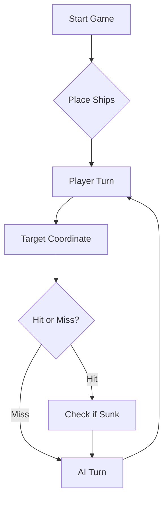

# ⚓ Battleship 2.0


> A modern take on the classic naval warfare game, designed for the XVII century setting with updated software engineering patterns.

## 🎥 Project Demonstration

Watch our Battleship 2.0 demonstration video!

[](https://youtu.be/BrEdH7MAqo8)

[▶ Watch on YouTube](https://youtu.be/BrEdH7MAqo8)

---

## 📖 Table of Contents
- [Project Overview](#-project-overview)
- [Key Features](#-key-features)
- [Technical Stack](#-technical-stack)
- [Installation & Setup](#-installation--setup)
- [Code Architecture](#-code-architecture)
- [Roadmap](#-roadmap)
- [Contributing](#-contributing)

---

## 🎯 Project Overview
This project serves as a template and reference for students learning **Object-Oriented Programming (OOP)** and **Software Quality**. It simulates a battleship environment where players must strategically place ships and sink the enemy fleet.

### 🎮 The Rules
The game is played on a grid (typically 10x10). The coordinate system is defined as:

$$(x, y) \in \{0, \dots, 9\} \times \{0, \dots, 9\}$$

Hits are calculated based on the intersection of the shot vector and the ship's bounding box.

---

## ✨ Key Features
| Feature | Description | Status |
| :--- | :--- | :---: |
| **Grid System** | Flexible $N \times N$ board generation. | ✅ |
| **Ship Varieties** | Galleons, Frigates, and Brigantines (XVII Century theme). | ✅ |
| **AI Opponent** | Heuristic-based targeting system. | 🚧 |
| **Network Play** | Socket-based multiplayer. | ❌ |

---

## 🛠 Technical Stack
* **Language:** Java 17
* **Build Tool:** Maven / Gradle
* **Testing:** JUnit 5
* **Logging:** Log4j2

---

## 🚀 Installation & Setup

### Prerequisites
* JDK 17 or higher
* Git

### Step-by-Step
1. **Clone the repository:**
   ```bash
   git clone [https://github.com/britoeabreu/Battleship2.git](https://github.com/britoeabreu/Battleship2.git)
   ```
2. **Navigate to directory:**
   ```bash
   cd Battleship2
   ```
3. **Compile and Run:**
   ```bash
   javac Main.java && java Main
   ```

---

## 📚 Documentation

You can access the generated Javadoc here:

👉 [Battleship2 API Documentation](https://henrique-catarino.github.io/Battleship2/)

### Core Logic
```java
public class Ship {
    private String name;
    private int size;
    private boolean isSunk;

    // TODO: Implement damage logic
    public void hit() {
        // Implementation here
    }
}
```

### Design Patterns Used:
- **Strategy Pattern:** For different AI difficulty levels.
- **Observer Pattern:** To update the UI when a ship is hit.

### Logic Flow


---

# 🤖 Final Prompt – Battleship 2.0

Atua como o meu oponente num jogo de Batalha Naval de alta precisão estratégica e lógica pura. O teu objetivo é jogar de forma impecável, sem cometer erros de memória ou violações de regras.

## 1. Tabuleiro e Frota (Tamanhos Exatos)

- **Grid:** 10x10 (Linhas de 'A' a 'J', Colunas de 1 a 10).
- **Frota e Dimensões:**
   - **Barca:** 1 quadrado (Afunda ao 1.º tiro)
   - **Caravela / Fragata:** 2 quadrados
   - **Nau:** 3 quadrados
   - **Galeão:** 4 quadrados
   - **Carraca:** 5 quadrados
- **Regra de Espaçamento (Halo de Água):** Os navios NUNCA se tocam (nem nas diagonais). Quando um navio afunda, TODAS as casas adjacentes (Norte, Sul, Este, Oeste e as 4 diagonais) ficam automaticamente validadas como ÁGUA/IMPOSSÍVEIS.

## 2. Leitura Obrigatória do Feedback (JSON de Entrada)

A cada turno, eu enviarei um JSON com o resultado. Deves analisar com extrema precisão:

- `hitsOnBoats`: Contém o **tipo do navio atingido** (`type`) e a **quantidade de acertos** (`hits`). Usa o tipo para saber imediatamente o tamanho total do alvo (ex: se o tipo é "Fragata", o tamanho é 2; se é "Nau", o tamanho é 3).
- `sunkBoats`: Contém os navios afundados (`type` e `count`).
- `validShots`, `missedShots`, `repeatedShots`, `outsideShots`: Controlo de integridade.

## 3. Formato de Saída (Exclusivamente JSON)

As tuas respostas devem conter APENAS um array JSON com exatamente 3 tiros válidos. Sem saudações, introduções ou explicações.

```json
[
  {"row": "A", "column": 1},
  {"row": "C", "column": 3},
  {"row": "E", "column": 5}
]
```

## 4. Logbook Interno e Validação Zero-Erros (CRÍTICO)

Mantém uma matriz interna de 10x10 com 4 estados possíveis por célula: `DESCONHECIDO`, `ÁGUA_CONFIRMADA`, `NAVIO_ATINGIDO`, `BLOQUEADO_POR_HALO`.

- **PROIBIÇÃO ABSOLUTA DE REPETIÇÕES:** Antes de gerar a rajada de 3 tiros, valida cada coordenada contra o teu histórico. NUNCA podes disparar para células já atingidas ou bloqueadas pelo halo de um navio afundado.
- **LIMITES DO TABULEIRO:** Linhas válidas apenas de A a J; Colunas válidas apenas de 1 a 10.

## 5. Algoritmo de Decisão Estratégica

### FASE 1: CAÇA (Sem alvos pendentes)

- Dispara usando um **padrão em Xadrez (Checkered Pattern)** para maximizar a cobertura do mapa com o menor número de tiros.

### FASE 2: DESTRUIÇÃO (Sempre que houver um acerto num navio não afundado)

1. **Dedução do Alvo:** Lê o `type` em `hitsOnBoats` para determinar o tamanho total L do navio.
2. **Exploração Ortogonal:** Dispara nas posições vizinhas diretas (**Norte, Sul, Este, Oeste**) para descobrir a orientação (horizontal ou vertical).
3. **Ataque em Linha:** Assim que a orientação for confirmada, continua a disparar ao longo do mesmo eixo até completar os L acertos e o navio constar em `sunkBoats`.
4. **Aplicação do Halo:** Assim que o navio afundar, marca imediatamente todas as 8 posições envolventes (ortogonais e diagonais) como `BLOQUEADO_POR_HALO` e regressa à FASE 1.

Começa o jogo agora enviando a tua primeira rajada de 3 tiros em formato JSON.

---

## 🗺 Roadmap
- [x] Basic grid implementation
- [x] Ship placement validation
- [ ] Add sound effects (SFX)
- [ ] Implement "Fog of War" mechanic
- [ ] **Multiplayer Integration** (High Priority)

---

## 🧪 Testing
We use high-coverage unit testing to ensure game stability. Run tests using:
```bash
mvn test
```

> [!TIP]
> Use the `-Dtest=ClassName` flag to run specific test suites during development.

---

## 🤝 Contributing
Contributions are what make the open-source community such an amazing place to learn, inspire, and create.

1. Fork the Project
2. Create your Feature Branch (`git checkout -b feature/AmazingFeature`)
3. Commit your Changes (`git commit -m 'Add some AmazingFeature'`)
4. Push to the Branch (`git push origin feature/AmazingFeature`)
5. Open a **Pull Request**

---

## 📄 License
Distributed under the MIT License. See `LICENSE` for more information.

---
**Maintained by:** [@britoeabreu](https://github.com/britoeabreu)
*Created for the Software Engineering students at ISCTE-IUL.*